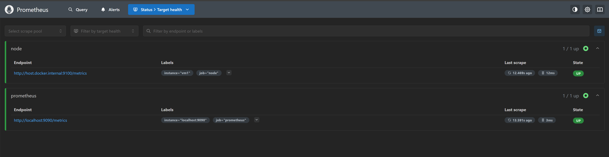
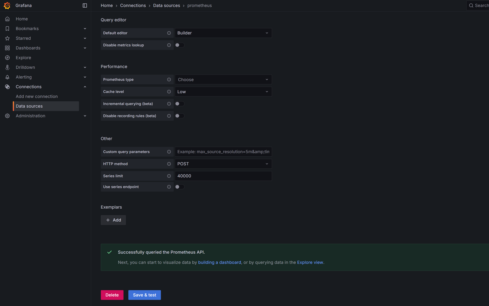
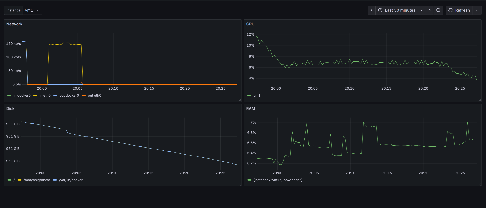

# ДЗ3: мониторинг + docker образ для counter-backend

делал на wsl2 (ubuntu 24.04), docker ставил в первой домашке

## Задание 1. мониторинг

в `monitoring/prometheus/prometheus.yml` добавил задание node, метка instance=vm1:

```yaml
  - job_name: node
    static_configs:
      - targets: [host.docker.internal:9100]
        labels:
          instance: vm1
```

запуск

```bash
cd monitoring
docker compose up -d
docker compose ps
```
```
NAME                         IMAGE                       COMMAND                  SERVICE         CREATED          STATUS          PORTS
monitoring-grafana-1         grafana/grafana:12.1.0      "/run.sh"                grafana         39 seconds ago   Up 29 seconds   127.0.0.1:3000->3000/tcp
monitoring-node-exporter-1   prom/node-exporter:v1.9.1   "/bin/node_exporter …"   node-exporter   39 seconds ago   Up 28 seconds
monitoring-prometheus-1      prom/prometheus:v3.5.0      "/bin/prometheus --c…"   prometheus      39 seconds ago   Up 29 seconds   127.0.0.1:9090->9090/tcp
```

node exporter отдает метрики

```bash
curl -s localhost:9100/metrics | grep ^node_ | head -5
```
```
node_arp_entries{device="br-32272c47dcd8"} 1
node_arp_entries{device="eth0"} 1
node_boot_time_seconds 1.791735528e+09
node_context_switches_total 1.815515e+06
node_cooling_device_cur_state{name="0",type="Processor"} 0
```

targets в prometheus, node в UP



data source в grafana (url `http://prometheus:9090`, т.к. графана и прометеус в одной docker сети), Save & test прошел



дашборд делал сам, 4 панели + переменная instance (`label_values(node_uname_info, instance)`). json лежит в `monitoring/grafana/dashboard.json`

запросы:

- CPU, %: `100 - avg by (instance) (rate(node_cpu_seconds_total{instance=~"$instance", mode="idle"}[5m])) * 100`
- RAM (занято), %: `(1 - node_memory_MemAvailable_bytes{instance=~"$instance"} / node_memory_MemTotal_bytes{instance=~"$instance"}) * 100`
- Disk (свободно), байты: `node_filesystem_avail_bytes{instance=~"$instance", fstype="ext4"}`
- Network, бит/с: `rate(node_network_receive_bytes_total{instance=~"$instance", device!~"lo|veth.*|br-.*"}[5m]) * 8` и то же с transmit. veth и br- убрал, это интерфейсы контейнеров, их там куча



## Задание 2. Dockerfile для counter-backend

файлы в `counter-backend/`: `Dockerfile.single`, `Dockerfile.multistage`, `Dockerfile.nonroot`, `.dockerignore`

в установку poetry добавил `poetry-plugin-export`, т.к. в poetry 2.x без него нет команды `poetry export`

### single

```bash
docker build -f Dockerfile.single -t counter-backend:single .
docker run -d --name cb-single -p 8081:8080 counter-backend:single
curl -s localhost:8081/api/counter
curl -s -X POST localhost:8081/api/counter
curl -s localhost:8081/api/counter
docker exec cb-single id
```
```
Successfully built 71c8c21d7cf7
Successfully tagged counter-backend:single

{"count": 0}
{"count": 1}
{"count": 1}
uid=0(root) gid=0(root) groups=0(root)
```

### multistage

```bash
docker build -f Dockerfile.multistage -t counter-backend:multistage .
docker run -d --name cb-multistage -p 8082:8080 counter-backend:multistage
curl -s localhost:8082/api/counter
curl -s -X POST localhost:8082/api/counter
curl -s localhost:8082/api/counter
docker exec cb-multistage id
```
```
[+] Building 156.6s (15/15) FINISHED
 => [build 2/6] RUN python -m pip install ... poetry poetry-plugin-export setuptools wheel
 => [build 3/6] COPY pyproject.toml poetry.lock README.md ./
 => [build 4/6] RUN mkdir -p dist && poetry export ... && poetry run python -m pip wheel ...
 => [build 5/6] COPY src/ src/
 => [build 6/6] RUN poetry build --format wheel
 => [final 2/3] COPY --from=build /build/dist/ dist/
 => [final 3/3] RUN packages=$( find 'dist' 'dist/vendor' ...
 => => naming to docker.io/library/counter-backend:multistage

{"count": 0}
{"count": 1}
{"count": 1}
uid=0(root) gid=0(root) groups=0(root)
```

### nonroot

```bash
docker build -f Dockerfile.nonroot -t counter-backend:nonroot .
docker run -d --name cb-nonroot -p 8083:8080 counter-backend:nonroot
curl -s localhost:8083/api/counter
curl -s -X POST localhost:8083/api/counter
curl -s localhost:8083/api/counter
docker exec cb-nonroot id
```
```
[+] Building 76.7s (16/16) FINISHED
 => [final 1/4] RUN addgroup --gid "1001" "user" && adduser --disabled-password --gecos "" --home "/app" --ingroup "user" --uid "1001" "user"
 => [final 2/4] WORKDIR /app
 => [final 3/4] COPY --from=build /build/dist/ dist/
 => [final 4/4] RUN packages=$( find 'dist' 'dist/vendor' ...
 => => naming to docker.io/library/counter-backend:nonroot

{"count": 0}
{"count": 1}
{"count": 1}
uid=1001(user) gid=1001(user) groups=1001(user),100(users)
```

### размеры образов

```bash
docker images counter-backend
```
```
IMAGE                        ID             DISK USAGE   CONTENT SIZE
counter-backend:multistage   dbdc4b71acd3        234MB         58.8MB
counter-backend:nonroot      6412d810e9e0        234MB         58.8MB
counter-backend:single       71c8c21d7cf7        380MB         95.6MB
```

| образ | размер | пользователь |
|---|---|---|
| single | 380 MB | root |
| multistage | 234 MB | root |
| nonroot | 234 MB | user (1001) |

multistage меньше на ~146 MB, потому что в финальный образ не попадает poetry и все что нужно только для сборки, только готовые wheel. nonroot весит столько же, пользователь почти ничего не добавляет
